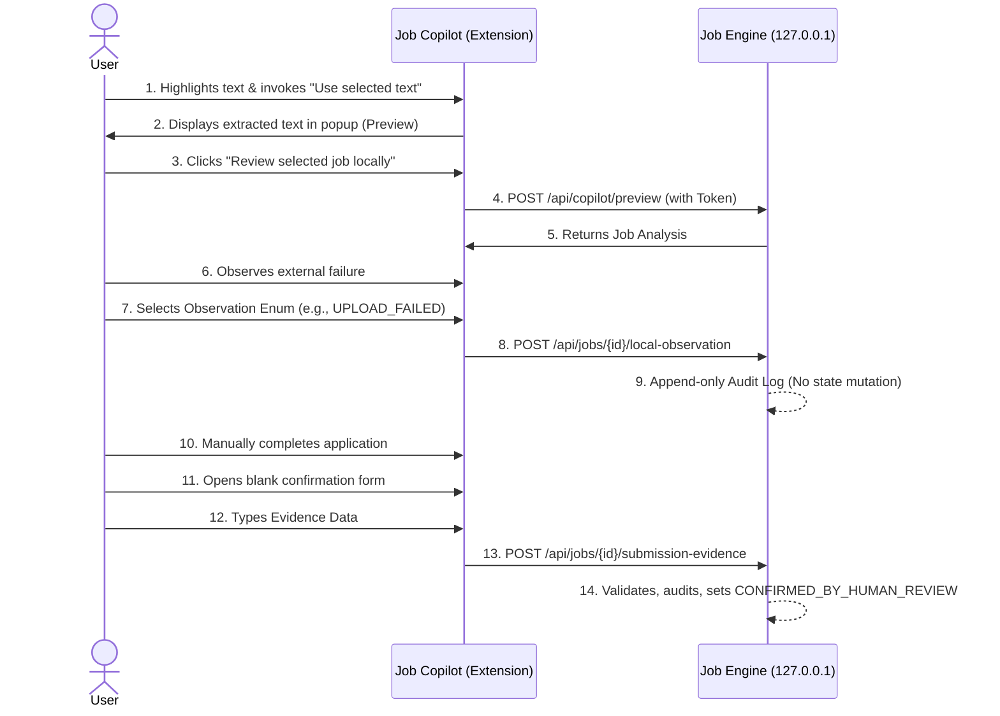

# Job Copilot & Job Engine Integration Plan (Revised)

## 1. Endpoint Contract

The Job Engine exposes a dedicated set of secure API endpoints strictly for the Copilot extension. Every request requires the `X-Job-Copilot-Token` header.

*   `POST /api/copilot/preview`
    *   **Auth**: `X-Job-Copilot-Token`
    *   **Input**: Explicit user-selected text or manually pasted text (String).
    *   **Action**: Ephemeral parsing and matching against the local profile. No database mutations.
    *   **Output**: Analysis (Missing skills, matched skills, fit score, eligibility gate).
*   `POST /api/copilot/import`
    *   **Auth**: `X-Job-Copilot-Token`
    *   **Input**: Explicit user-selected text or manually pasted text (String) + User Consent.
    *   **Action**: Persists the job in the local database with state `NEW`.
    *   **Output**: Job ID.
*   `POST /api/jobs/{id}/local-observation`
    *   **Auth**: `X-Job-Copilot-Token`
    *   **Input**: Strictly controlled `event_type` enum (e.g., `RESUME_UPLOAD_FAILED`). **No** arbitrary page text, raw URLs, screenshots, form values, or file names.
    *   **Action**: Append-only log recording an audit event. Does **not** mutate job-state, eligibility, evidence, draft, or submission-status.
    *   **Output**: Acknowledgment.
*   `POST /api/jobs/{id}/submission-evidence`
    *   **Auth**: `X-Job-Copilot-Token`
    *   **Input**: Structured evidence data submitted from a blank, human-entered form in the Copilot UI.
    *   **Action**: Backend validates the input, writes the audit record, sets `verified_at` and `audit_id`, and classifies the record as `CONFIRMED_BY_HUMAN_REVIEW`.
    *   **Output**: Acknowledgment.

## 2. Extension Permission Plan (Manifest V3)

The extension strictly adheres to the principle of least privilege.

```json
{
  "permissions": [
    "activeTab",
    "storage"
  ],
  "host_permissions": [
    "http://127.0.0.1:8000/*"
  ]
}
```

*   **`activeTab`**: Grants temporary active-tab access *only* after explicit user invocation (e.g., clicking the extension icon or triggering a context menu for a "Use selected text" action). It is not fully passive; it explicitly gates access behind a user gesture.
*   **`storage`**: Used exclusively to store local settings and the local API token.
*   **`host_permissions`**: Strictly bound to `http://127.0.0.1:8000/*` to allow CORS requests to the local engine.

**Explicitly Prohibited Permissions:**
`<all_urls>`, `tabs`, `scripting`, `debugger`, `cookies`, `webRequest`, `downloads`, and `clipboardRead` are explicitly prohibited unless separately reviewed.

## 3. Data-Flow Diagram



## 4. Local API Authentication & Privacy

*   **Random Local Token**: A random local token is generated during backend configuration and stored manually in the extension's `storage`.
*   **Header**: The token is passed via the `X-Job-Copilot-Token` header on every request.
*   **Validation**: The backend strictly rejects any missing or invalid token.
*   **Lifecycle**: The backend supports a token rotation/revocation process.
*   **Isolation**: The token is strictly read from `chrome.storage.local` within the extension's isolated context (popup or background service worker). It is **never** exposed to content scripts or the webpage context.
*   **Data Minimization**: The extension relies purely on manual paste into the popup or explicit "Use selected text" actions. The extension must **not** read titles, companies, descriptions, form fields, page HTML, hidden page data, or the page-wide DOM automatically.

## 5. State-Transition Rules

*   **Observations are Append-Only**: Calling the local observation endpoint logs an event but never mutates the overall job state. 
*   **No Extension Inference**: The extension never infers evidence from a webpage.
*   **Server-Side Confirmation**: Only the Job Engine backend, after validating the human-entered data from the blank confirmation form, may classify a record as `CONFIRMED_BY_HUMAN_REVIEW`.

## 6. Threat Model

1.  **Malicious webpages attempting to call localhost**: Mitigated by strictly requiring the `X-Job-Copilot-Token` header. Standard web pages cannot attach custom headers to cross-origin requests without a preflight CORS allowance, which the backend will reject.
2.  **Token theft**: Token is isolated in extension background storage. It is never injected into content scripts or exposed to the DOM, protecting it from malicious page scripts.
3.  **Unpacked extension ID changes**: If the extension ID changes, the backend's explicit CORS whitelist will block the new ID until the configuration is updated by the user.
4.  **Oversized selected text**: Backend enforces a strict request body size limit, discarding payloads exceeding safe boundaries (e.g., > 100KB) to prevent resource exhaustion.
5.  **Sensitive-data leakage**: Because extraction is entirely manual (paste or selected text), the extension cannot inadvertently scrape background sessions, hidden inputs, or non-visible PII.
6.  **CSRF-like local requests**: The mandatory `X-Job-Copilot-Token` inherently prevents CSRF vulnerabilities.
7.  **XSS in popup output**: All responses from the backend (e.g., missing skills, reasoning) are treated as untrusted text and strictly sanitized/escaped before rendering in the extension popup HTML.
8.  **Extension compromise**: If the extension is compromised, the user can revoke/rotate the local API token in the Job Engine backend, instantly severing the connection.
9.  **Incorrect human confirmation**: If the human incorrectly confirms a submission, the system tracks this via the `verified_at` and `audit_id` fields. The blast radius is limited since no automated external side-effects result from this state.

## 7. Tests-First Acceptance Criteria

The following tests must be written and pass before implementation:

*   **Authentication**: No request is accepted without a valid local token in the header.
*   **CORS/Origin**: Requests with the wrong or missing Origin are rejected.
*   **Validation (Observation)**: Unknown observation events (not in the strict enum) are rejected.
*   **Validation (Payload)**: Oversized selected text is cleanly rejected (413 Payload Too Large).
*   **Immutability**: Review and observation endpoints do **not** mutate the `JobModel` or submission status.
*   **Validation (Evidence)**: Invalid or incomplete confirmation evidence is rejected by the backend.
*   **No Automations**: No automatic confirmation of submission states is allowed.
*   **Manifest Verification**: Tests parsing `manifest.json` to ensure it contains no prohibited permissions (`<all_urls>`, `tabs`, `scripting`, etc.).
*   **Source Verification**: Static analysis (AST or regex) verifying the extension source code contains no DOM-wide extraction, form handling, upload logic, synthetic click, automated submit, or browser-automation logic.

## 8. Explicit List of Prohibited Capabilities

The following behaviors are strictly banned:

*   Requesting `<all_urls>`, `tabs`, `scripting`, `debugger`, `cookies`, `webRequest`, `downloads`, or `clipboardRead` in the extension manifest.
*   Executing selector-based or automated page extraction (e.g., `document.querySelector`).
*   Reading title, company, description, form fields, page HTML, hidden page data, or page-wide DOM automatically.
*   Inferring successful application submission from webpage state or URLs.
*   Clicking elements, auto-filling forms, submitting forms, or uploading files.
*   Sending raw arbitrary text, URLs, screenshots, file names, or form values in observation payloads.
*   Exposing the API token to content scripts or webpage contexts.
*   Mutating job states or submission statuses via observation endpoints.
*   Automatically parsing or transmitting page content without explicit user action.
